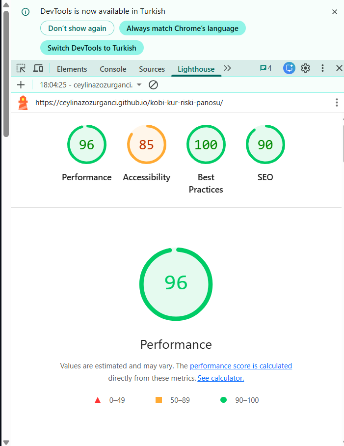
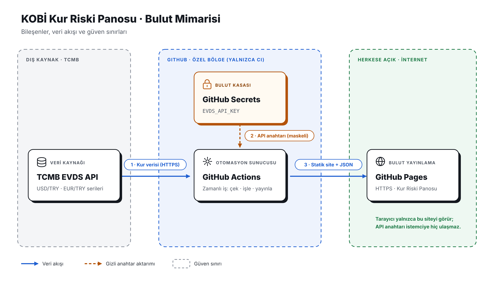

# kobi-kur-riski-panosu
# KOBİ Kur Riski & Hedging Yönetim Panosu

Bu proje, KOBİ'lerin döviz kuru dalgalanmalarından kaynaklanan finansal risklerini yönetmelerini ve türev ürün (Forward) koruma senaryolarını simüle etmelerini sağlayan canlı bir web uygulamasıdır.

🔗 **Canlı Pano:** [https://ceylinazozurganci.github.io/kobi-kur-riski-panosu/](https://ceylinazozurganci.github.io/kobi-kur-riski-panosu/)

---

## 🚀 Öne Çıkan Özellikler

- **Canlı TCMB Veri Entegrasyonu:** `fetch_data.py` betiği ile güncel kur verileri otomatik olarak çekilir.
- **Güvenli Bulut Mimarisi:** API anahtarları `GitHub Secrets` kasasında saklanır, `GitHub Actions` CI/CD hattı ile günlük güncellenir.
- **Etkileşimli Risk & Forward Simülatörü:** İthalat hacmi, vade ve şok kur oranlarına göre anlık risk ve tasarruf hesabı yapar.
- **Akıllı Karar Destek Asistanı:** Kur riski seviyesine göre dinamik strateji ve aksiyon önerisi sunar.
- **Erişilebilirlik & WCAG Uyumlu:** Tek tıkla aktifleşen Yüksek Kontrast modu ve responsive UI.
- **Veri Dışa Aktarımı:** İnceleme ve raporlama için `.CSV` formatında veri indirme seçeneği.

---

## 🛠️ Kullanılan Teknolojiler

- **Frontend:** HTML5, CSS3 (Glassmorphism), JavaScript (ES6+), Chart.js
- **Backend & Otomasyon:** Python (Pandas, Requests), GitHub Actions
- **Bulut & Güvenlik:** GitHub Pages, GitHub Secrets, TCMB EVDS API

---

## 📊 Test ve Kalite Metrikleri (Lighthouse)

- **Performance:** 96/100
- **Accessibility:** 85/100
- **Best Practices:** 100/100
- **SEO:** 90/100

---

## 📐 Bulut Mimari Şeması

